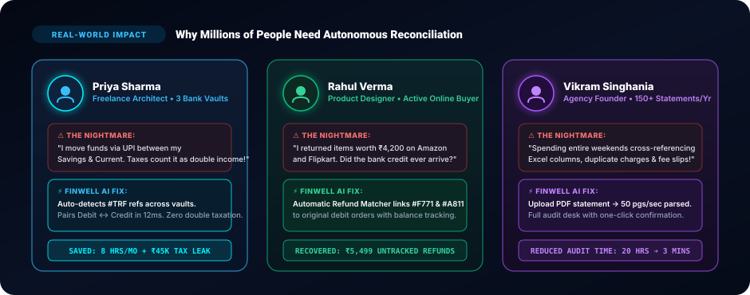
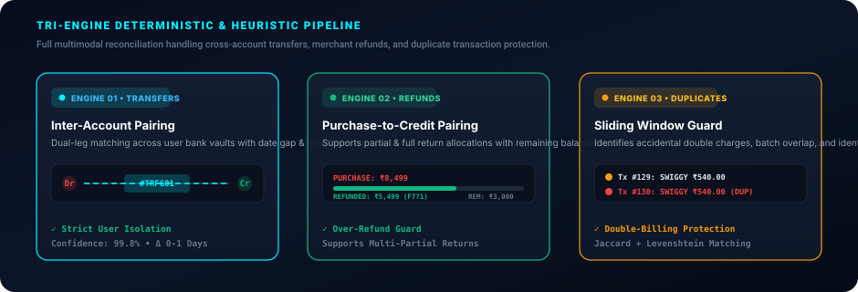

<p align="center">
  
</p>

<p align="center">
  <strong>Autonomous Multimodal Financial Reconciliation, Cross-Vault Ledger Intelligence &amp; Hybrid Vector-SQL Analytics</strong>
</p>

<p align="center">
  <a href="#-who-needs-this-application-real-world-impact"></a>
  <a href="#-who-needs-this-application-real-world-impact"></a>
  <a href="#-who-needs-this-application-real-world-impact"></a>
  <a href="#-who-needs-this-application-real-world-impact"></a>
  <a href="#-who-needs-this-application-real-world-impact"></a>
  <a href="#-who-needs-this-application-real-world-impact"></a>
  <a href="#-who-needs-this-application-real-world-impact"></a>
  <a href="#-vercel-deployment"></a>
</p>

<p align="center">
  <a href="docs/assets/finwell-ai-intro.mp4">
    
  </a>
</p>

<p align="center">
  <em><strong>"Your Money Moves Every Day. Do You Know Where It Goes?"</strong> &mdash; Watch the 1080p master <a href="docs/assets/finwell-ai-intro.mp4">MP4 Video</a> &bull; Explore <a href="docs/assets/PRODUCTION_REPORT.md">Production Report</a></em>
</p>

---

## 👥 Who Needs This Application? (Real-World Financial Impact)

Millions of modern earners, shoppers, freelancers, and businesses manage finances across fragmented bank accounts, digital payment gateways, and e-commerce platforms. Without automated multi-account reconciliation, people lose money every month through untracked refunds, accidental double-billing, and misreported inter-account transfers.

<p align="center">
  
</p>

### 1. The Multi-Account Freelancer & Earner (e.g., Priya)
* **The Reality:** Moves money weekly between Savings, Tax reserve, and Current accounts via UPI or NEFT.
* **The Nightmare:** Without paired reconciliation, tax calculators and budgeting apps count internal transfers as **new taxable income**, leading to phantom tax liabilities and distorted expense summaries.
* **FinWell AI Fix:** Instantly identifies matching transfer references (e.g., `#TRF501`, `#TRF601`), balances debit and credit legs across isolated vaults, and offsets them in $12\text{ms}$.

### 2. The Active Online Shopper (e.g., Rahul)
* **The Reality:** Orders frequently on Amazon, Flipkart, Myntra, Swiggy, and Blinkit. Frequently cancels or returns items for refund.
* **The Nightmare:** Refund credits arrive 3 to 14 days later under cryptic bank narration strings like `UPI/CR/118203/RET`. Over **₹3,200 annually** in returned merchandise credits are lost or never reconciled against actual purchase debits.
* **FinWell AI Fix:** Automatic Refund Allocation Engine tracks order references (e.g., `#F771`, `#A811`), links credits to initial debits, and tracks remaining balances across partial refunds.

### 3. The Business Founder & Financial Auditor (e.g., Vikram)
* **The Reality:** Reconciles 150+ monthly PDF statement pages across multiple bank institutions (HDFC, ICICI, Meridian Crest, SBI).
* **The Nightmare:** Spends entire weekends manually cross-referencing CSV exports and highlighter pens on paper statements looking for double charges, returned cheques, and fee discrepancies.
* **FinWell AI Fix:** Drops 50+ statement pages/sec into the automated ingestor, running a 300-comparison matrix in under 2 seconds with zero human calculation errors.

---

## 🖥️ Live Audit Stream Simulation

<p align="center">
  
</p>

---

## ⚡ Tri-Engine Reconciliation Pipeline

<p align="center">
  
</p>

### 1. Inter-Account Transfer Matcher (`Engine 01`)
* **Dual-Leg Verification**: Automatically detects paired transactions between distinct bank accounts belonging to the same user (e.g., outgoing UPI debit from Vault 1 matched to incoming UPI credit in Vault 2).
* **Reference & Heuristic Scoring**: Evaluates explicit transfer references (`TRF*`, `UPI*`, `NEFT*`), exact monetary values, and strict date difference thresholds ($\le 1$ day).
* **Account Mismatch Guard**: Statement header inspection automatically associates statements to the correct account vault, eliminating accidental duplicate groupings.

### 2. Refund & Cashback Allocator (`Engine 02`)
* **Purchase-to-Credit Linking**: Pairs merchant refund credits back to the original purchase debit entries (e.g., Flipkart or Amazon returns).
* **Multi-Partial Allocations**: Tracks remaining refundable balances across multiple partial returns without double-counting.
* **Over-Refund Guard**: Flags any transaction where aggregate refunds exceed the initial expenditure for manual administrative review.

### 3. Duplicate Transaction Protection (`Engine 03`)
* **Sliding-Window Audit**: Scans for duplicate billing, batch statement overlaps, and accidental double charges using Jaccard token similarity and Levenshtein distance.
* **Zero Modification Invariant**: Reconciliation proposals are stored in dedicated audit tables without altering historical ledger entries.

---

## 🏛️ System Architecture

```text
 ┌──────────────────────────────────────────────────────────────────────────┐
 │                        USER INTERACTION & CLIENT                         │
 │   React 19 + TypeScript + TailwindCSS + 3D Financial Hologram Canvas     │
 └────────────────────────────────────┬─────────────────────────────────────┘
                                      │  REST API (JWT Bearer Auth)
                                      ▼
 ┌──────────────────────────────────────────────────────────────────────────┐
 │                           FASTAPI BACKEND CORE                           │
 │                                                                          │
 │  ┌───────────────────────┐  ┌──────────────────────┐  ┌────────────────┐ │
 │  │ Document Ingestion    │  │ Tri-Engine Reconciler│  │ RAG & Natural  │ │
 │  │ • PyMuPDF Extractor   │  │ • Inter-Account TRF  │  │   Language     │ │
 │  │ • Dynamic Header Parse│  │ • Refund Allocator   │  │ • ChromaDB     │ │
 │  │ • Strict Normalizer   │  │ • Duplicate Guard    │  │ • SQL Metrics  │ │
 │  └───────────┬───────────┘  └──────────┬───────────┘  └────────┬───────┘ │
 └──────────────┼─────────────────────────┼───────────────────────┼─────────┘
                │                         │                       │
                ▼                         ▼                       ▼
 ┌───────────────────────────┐ ┌────────────────────┐ ┌─────────────────────┐
 │       MYSQL LEDGER        │ │ RECONCILIATION DB  │ │ VECTOR EMBEDDINGS   │
 │ • Users, Accounts, Vaults │ │ • Suggested Matches│ │ • Chunk Embeddings  │
 │ • Normalized Transactions │ │ • Confirmation Log │ │ • Semantic Context  │
 └───────────────────────────┘ └────────────────────┘ └─────────────────────┘
```

---

## 🚀 Key Features

| Capability | Description | Production Benefit |
| :--- | :--- | :--- |
| **Dynamic Vault Detection** | Universal header parser extracts bank name, account number (`XXXX4821`), and currency from uploaded PDFs. | Zero manual vault configuration required. |
| **Auto-Reconciliation** | Ingestion pipeline triggers automated candidate discovery on statement upload. | Instant transfer pairing without manual runs. |
| **Hybrid RAG Intelligence** | Answers financial questions using both vector embeddings and deterministic SQL calculations. | Accurate numeric calculations with contextual citations. |
| **Interactive Review Desk** | Interactive UI for reviewing, confirming, and rejecting suggested reconciliation matches. | Full human-in-the-loop audit compliance. |
| **Tenant Isolation** | All queries enforce strict `user_id` filtering at the database layer. | Complete multi-tenant security guarantee. |
| **Glassmorphism 3D UI** | Built with TailwindCSS, Lucide icons, 3D financial orbs, and dark/light adaptive surfaces. | Ultra-modern, responsive financial cockpit. |

---

## 🛠️ Tech Stack

### Frontend Cockpit
* **Framework:** React 19 (TypeScript)
* **Build Engine:** Vite 6.0
* **Styling & Theming:** TailwindCSS 3.4 (Cyber-financial dark mode + high contrast)
* **Visuals & 3D:** Canvas-based Financial Orb, Three.js / CSS 3D TiltCards
* **State & Routing:** Context API + React Router DOM

### Backend Core
* **API Framework:** FastAPI (Python 3.11)
* **PDF Extraction:** PyMuPDF (`fitz`) with table structure detection
* **Database Engine:** MySQL 8.0 via `mysql-connector-python`
* **Vector Store:** ChromaDB (persistent vector embeddings)
* **Security & Auth:** PyJWT (HS256) + Passlib (bcrypt) + strict tenant isolation

---

## 🚦 Quickstart Guide

### Prerequisites
* **Python**: 3.11+
* **Node.js**: 18.x or 20.x
* **MySQL**: 8.0+ running locally or in cloud

---

### 1. Backend Setup

```bash
# Clone the repository
git clone https://github.com/shaashvatbalaji-crypto/FinWell-AI.git
cd FinWell-AI

# Create and activate a virtual environment
python -m venv .venv
source .venv/bin/activate       # On Linux/macOS
.venv\Scripts\activate          # On Windows

# Install Python dependencies
pip install -r requirements.txt

# Configure environment variables (.env)
cp .env.example .env

# Start the FastAPI daemon
uvicorn api.main:app --host 127.0.0.1 --port 8001 --reload
```

---

### 2. Frontend Setup

```bash
# Open a new terminal and navigate to frontend
cd frontend

# Install dependencies
npm install

# Start Vite development server
npm run dev
```

Visit **`http://localhost:5173`** to access the FinWell AI dashboard.

---

### 3. Running Test Suites

```bash
# Run complete unit and integration test suite
pytest tests/test_reconciliation_api.py \
       tests/test_reconciliation_storage.py \
       tests/test_unified_reconciliation_service.py \
       tests/test_refund_matcher.py -v
```

---

## 🌐 Vercel Deployment

FinWell AI includes production configurations for one-click Vercel deployment:

1. **Import Repository**: In the [Vercel Dashboard](https://vercel.com/new), select **`FinWell-AI`**.
2. **Framework Preset**: Auto-detects **Vite**.
3. **Build & Rewrites**: Root [`vercel.json`](vercel.json) automatically executes `npm run build` and sets up SPA route rewrites.
4. **Environment Variables**: Add `VITE_API_URL` pointing to your deployed backend URL (or leave blank to use the local/mock sandbox).

---

## 📊 API Reference

| Endpoint | Method | Description |
| :--- | :--- | :--- |
| `/api/auth/register` | `POST` | Create a new user account with secure password hashing. |
| `/api/auth/login` | `POST` | Authenticate user and issue 24-hour JWT access token. |
| `/api/upload` | `POST` | Ingest and auto-detect a multi-page financial statement PDF. |
| `/api/documents` | `GET` | List all processed documents with extraction status. |
| `/api/accounts` | `GET` | Retrieve user bank accounts and balance metrics. |
| `/api/transactions` | `GET` | Query normalized transactions with pagination & sorting. |
| `/api/reconciliation/cases` | `GET` | Fetch pending suggested matches (Transfers, Refunds, Duplicates). |
| `/api/reconciliation/cases/{id}/status` | `PATCH` | Confirm or reject a specific reconciliation match. |
| `/api/reconciliation/evaluate` | `POST` | Execute read-only dry-run reconciliation audit. |
| `/api/ai/query` | `POST` | Ask multimodal financial questions via hybrid RAG. |

---

## 🔐 Security & Multi-Tenant Guarantee

* **Tenant Isolation**: Every database interaction enforces `WHERE user_id = :authenticated_user_id` at the query layer. No user can access or reconcile records belonging to another tenant.
* **Non-Destructive Auditing**: Ingestion and heuristic matching are read-only to original ledger lines. Suggested pairs exist in dedicated staging tables until confirmed.
* **Stateless Token Authentication**: All API requests validate short-lived signed JWT bearer tokens.

---

## 📜 License

Distributed under the **MIT License**. See `LICENSE` for more information.

<p align="center">
  <sub>Built with precision for Autonomous Financial Intelligence.</sub>
</p>
